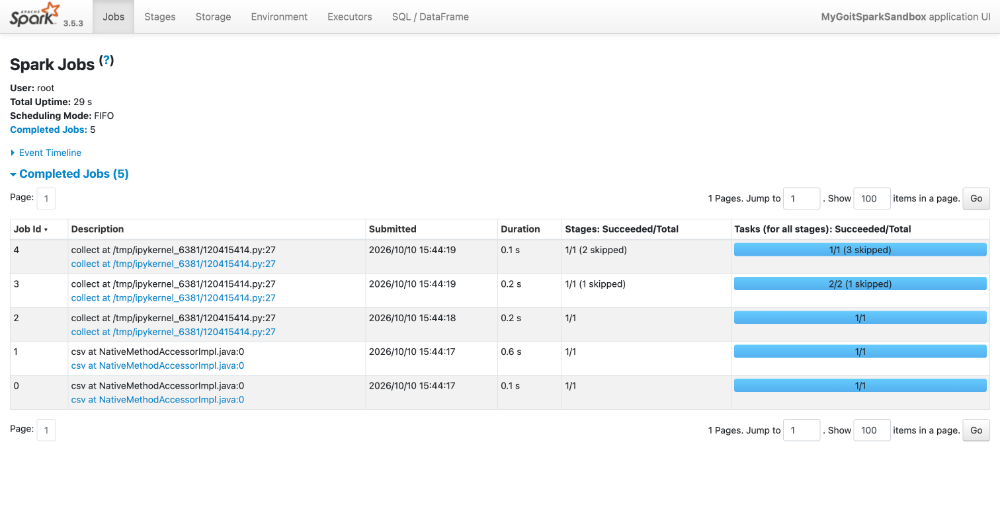
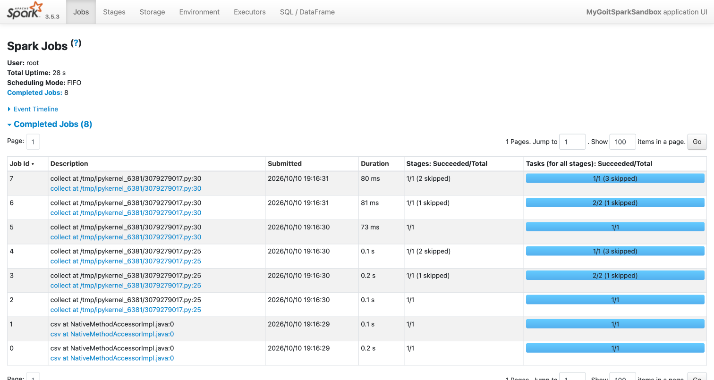
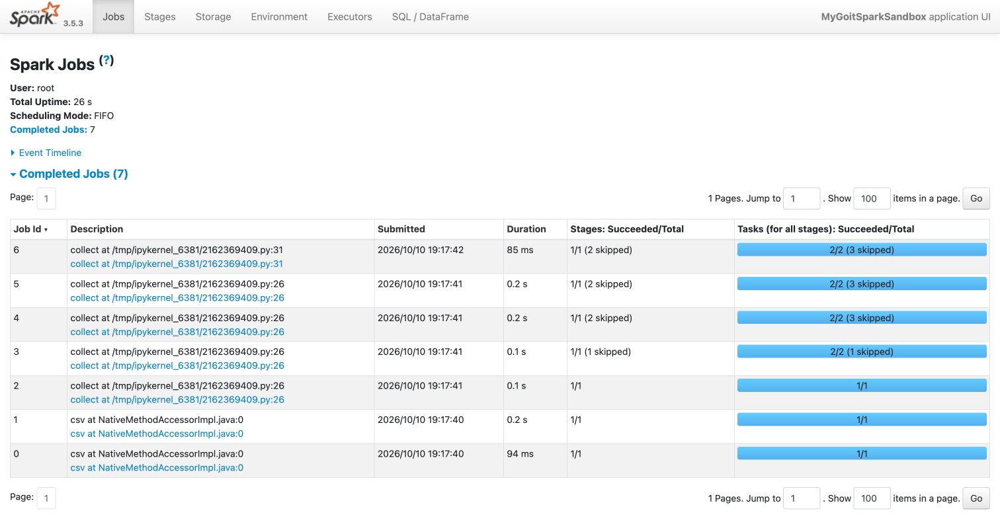

# goit-de-hw-04 — Apache Spark. Оптимізація та SparkUI

Домашнє завдання до теми «Apache Spark. Оптимізація та SparkUI».
Три варіанти однієї програми запускались по черзі, після кожного — скриншот сторінки
SparkUI **Jobs** (`http://localhost:4040/jobs/`).

Середовище: PySpark 3.5.3, `local[*]`, `spark.sql.shuffle.partitions = 2`, датасет `nuek-vuh3.csv`
(Fire Department Calls for Service). Запуск — Google Colab, SparkUI відкрито через проксі порту 4040.

| Частина | Код | Скриншот | Кількість Jobs |
|---|---|---|---|
| 1 | `part1.py` | `screenshots/part1_jobs.png` | 5 |
| 2 | `part2.py` | `screenshots/part2_jobs.png` | 8 |
| 3 | `part3.py` | `screenshots/part3_jobs.png` | 7 |

Ноутбук, у якому все запускалось: `colab_run.ipynb`.

Звіт зі скриншотами та описом: `ДЗ4_Сліпко_Людмила.docx`.

## Частина 1 — 5 Jobs



- **Job 0, Job 1** — читання CSV з `inferSchema=true`: перша Job читає заголовок, друга
  проходить весь файл, щоб визначити типи колонок.
- `repartition`, `where`, `select`, `groupBy().count()` і `where("count>2")` — це **трансформації**,
  вони нічого не запускають.
- **Job 2, 3, 4** — єдина дія `collect()`. Завдяки Adaptive Query Execution Spark виконує запит
  частинами (query stages): Job 2 — shuffle від `repartition(2)`, Job 3 — shuffle від `groupBy`,
  Job 4 — фінальна стадія з фільтром `count>2`. Уже виконані стадії в наступних Jobs позначені як *skipped*.

## Частина 2 — 8 Jobs (на 3 більше)



- Job 0, 1 — читання CSV (як у частині 1).
- Job 2, 3, 4 — **проміжний** `collect()`.
- Job 5, 6, 7 — другий `collect()` уже для нового DataFrame з `where("count>2")`.

**Чому на 3 Jobs більше?** Кожна дія (action) запускає весь ланцюжок трансформацій заново.
Spark не зберігає результат першого `collect()`, тому другий `collect()` знову проходить
ті самі етапи: shuffle після `repartition` → shuffle після `groupBy` → фінальна стадія.
Це ще 3 Jobs. Частину стадій Spark пропускає (*skipped*), бо shuffle-файли вже лежать на диску,
але самі Jobs все одно створюються.

## Частина 3 — 7 Jobs (на 1 менше, ніж у частині 2)



- Job 0, 1 — читання CSV.
- Job 2–5 — проміжний `collect()`: обчислення результату `groupBy().count()` і **збереження його в кеш**
  (`.cache()` додає ще одну Job для заповнення кешу).
- Job 6 — другий `collect()`: дані вже лежать у пам'яті, тож Spark бере їх із кешу,
  застосовує лише `where("count>2")` і не перераховує `repartition` та `groupBy`.

**Чому `cache()` зменшує кількість Jobs?** `cache()` зберігає проміжний DataFrame у пам'яті
після першої дії. Наступні дії читають готовий результат замість того, щоб знову виконувати
всі shuffle-етапи. Тому другий `collect()` дає лише 1 Job замість 3.
Після роботи пам'ять звільняється через `unpersist()`.

## Запуск локально

```bash
pip install pyspark
python part1.py   # відкрити http://localhost:4040/jobs/ поки програма чекає Enter
python part2.py
python part3.py
```
